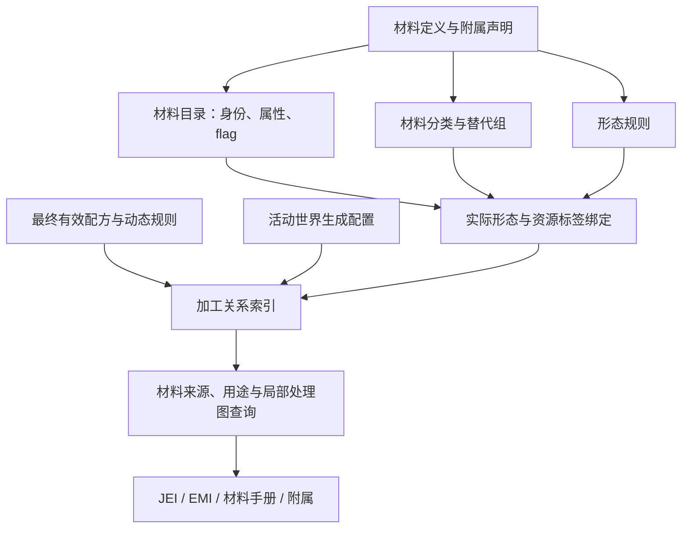

# 0001：材料数据 API 与加工关系视图

- 状态：部分实施；A（薄视图与 metadata）已完成，B 的 tag／替代组定义与查询随计划 02 完成，C 的形态规则、实际资源绑定与 tag 桥接声明随计划 03 完成；D—E 仍待实施。
- 日期、作者、关联任务：2026-11-07，材料系统重构设计；关联 [#351](https://github.com/GregTech6CE/GregTech6/issues/351) 与材料标签、形态、获取途径和处理图整合需求。
- 替代／被替代关系：无；补充[材料重构计划](../development/material-system-refactor/README.md)，不替代现行 API 契约。

本文确定数据边界、查询接口和扩展方式。分步实现与验证见[计划 08](../development/material-system-refactor/08-material-data-api.md)。A—C 的视图、metadata、分类与形态内容快照已经发布；来源和处理图接口仍是后续设计轮廓。

## 背景与约束

材料主对象已混合身份、物性、燃料、工具与矿石处理参数。直接往其中增加 tag、世界生成列表、合金列表和图布局，会让更多系统依赖一个可变对象，并重复存储世界和配方状态。

本次核对发现以下相互独立的数据路径：

| 现有入口 | 当前职责 | 接入设计时需处理的问题 |
| --- | --- | --- |
| `MaterialProperty`、`MaterialRoleFlags` | 类型、能力和后加角色 | 描述分类与加工授权混在相近概念里 |
| `MaterialGroups` | `AnyIron` 等替代组与 re-registration | 分组不应被理解成一个真实材料身份，也不等同组成相同 |
| `MaterialTagAliases`、`MaterialEquivalence` | 资源标签拼写、形态等价 | 标签映射、具体匹配与成分事实应有明确边界 |
| `MaterialTagPack` | 动态生成物品／方块／流体标签 | 夹杂材料映射、配方输入组和其他内容标签，不能全部搬到材料对象 |
| `MaterialPrefix`、`BlockMaterialPrefix`、`MaterialForms`、附属 form 请求 | 形态与生成条件 | 可生成、已注册和当前可获得是三种状态 |
| `MaterialDeclaration.oreByproducts`、矿石处理规则 | 有序副产物与工艺生成 | 一个材料数组不能描述各步骤的数量、概率、条件和副产物身份 |
| `WorldgenInfoData` | 汇集活动矿脉／小矿／岩层供展示 | 位于 JEI 包且含游戏对象；EMI 也调用它，应抽出共享数据投影 |
| `RecipeMap.allRecipes()`、unit／动态规则 | 运行时有效加工与枚举 | 全量枚举可能昂贵，部分动态匹配无法完整枚举 |

用户提供的矿物处理图展示了多阶段加工、分支和副产物。截图用作信息组织与交互目标；不能据图标推断当前仓库的准确配比、概率或工艺。具体数据仍以活动配方、世界生成规则和 parity 依据为准。

核心约束：Java 17 公共契约只用平台无关类型；主材料简洁；保留现有注册身份；允许附属扩展；数据包重载后查询与游戏行为一致；客户端绘图不能成为配方权威。

## 备选与决定

| 方案 | 收益 | 代价与结论 |
| --- | --- | --- |
| 在 `GTMaterial` 上增加所有字段和方法 | 初期调用直接 | 世界状态、图和配方形成双向依赖，不采用 |
| 维持独立 tag／来源／展示表，只增加汇总门面 | 迁移少 | 同一事实继续多处维护，不采用 |
| 轻量材料视图＋领域查询服务＋从有效内容派生的快照 | 共享身份与查询，事实仍归实际生产系统 | 需明确阶段与适配；采用为提议方案 |

整合的是材料身份、声明规范、查询入口和一致性约定。配方引擎继续执行配方，世界生成继续决定矿物分布；材料 API 查询它们发布的有效结果，不接管这些系统的实现。



### 1. 主材料只承载内在事实

主材料的公开只读视图保留稳定身份、展示信息、有类型的稀疏属性和 flag。它不持有世界生成、来源、全部配方、资源标签成员或图布局。

```java
// 提议轮廓；校验、构造器及其余访问器省略。
public record MaterialKey(String name) {}
public record DataKey(String namespace, String path) {}
public record FormKey(String name) {}
public record PropertyKey<T>(DataKey id, Class<T> type) {}

public interface MaterialView {
    MaterialKey key();
    MaterialInfo info();
    <T> java.util.Optional<T> property(PropertyKey<T> key);
    java.util.Set<DataKey> flags();
}

public interface MaterialCatalogView {
    long revision();
    java.util.Optional<MaterialView> find(MaterialKey key);
    MaterialTagsView tags();
    FormRulesView formRules();
}

public interface MaterialDataSnapshot {
    SnapshotStamp stamp();
    MaterialCatalogView catalog();
    MaterialFormsView forms();
    MaterialProcessesView processes();
}
```

- `MaterialKey` 使用已解析的现有规范名称，保留大小写语义；旧别名经目录解析。它不是动态数值 ID，不触发注册名或存档格式迁移。
- `DataKey` 用于新增属性、分类、组和操作类别的命名，构造时按各域验证；与 Minecraft `ResourceLocation` 无依赖。不同域的同名 key 不互相转换。
- `FormKey` 沿用已解析的 prefix 名，别名只由形态目录解析；此阶段不重命名现有 prefix 或物品／流体注册项。流体相态由形态描述关联现有绑定，不凭空生成新 prefix。
- `MaterialInfo` 含名称、现有 ID、展示键、颜色和定义来源等固定信息；组成、燃料、矿石、工具与热学等放对应类型化属性。
- `PropertyKey<T>` 的 ID 和类型须预先注册，同 ID 异类型失败；值必须符合不可变约定。公开写入使用类型化 builder，不接受任意 `Map<String,Object>`。
- 自定义 key 不自动获得宿主行为。新燃料／加工能力需要对应消费者；单纯分类标签不会授权回收或生成配方。

属性类型与客户端传输能力分开注册。首版同步宿主已知的不可变值类型；自定义属性需提供受支持的显式编码约定才能传输，未支持的客户端属性标为不可用。不得传 Java 类对象或通过反射反序列化任意附属类；服务端仍可在原类型下查询此属性。

这是公共只读模型；内部 `GTMaterial` 可以逐域改存储，再用适配器导出该视图，不需要立刻替换所有实例。

### 2. 明确区分四种 tag 语义

| 概念 | 示例 | 权威与效果 |
| --- | --- | --- |
| 材料分类 tag | 金属类、木材类、某附属的矿物族 | `MaterialTagsView` 的集合关系；可供明确声明的规则查询，单独加入不会改变行为 |
| 行为／生成 flag | 可锻造、允许某分解 map、生成某族形态 | 类型化能力声明及依赖校验；与分类 tag 不是同一集合 |
| 材料替代组 | `AnyIron`、`AnyWoodOrPlastic` | 显式组成员和指定工艺中的匹配规则；不合并材料身份、物性或成分 |
| Minecraft 资源 tag | `forge:ingots/iron`、`c:ingots/iron` | 游戏注册表的有效成员；由形态绑定导出或由外部包提供，经过适配后使用 |

拟议查询职责：`tags().contains(material, tag)`、`tags().members(tag)`、`tags().group(groupId)`。分类 tag 和 group 使用不同参数类型或独立方法，不允许互相误传。命名例子只说明类别，不直接决定最终 key 拼写。

材料 tag 声明可以包含其他同类 tag，校验未知引用与环；替代组是单独的选择器声明。组与组的嵌套若需支持，按独立的无环成员规则展开。`AnyIron` 的旧内部伪材料在迁移期可保留适配，但新公开 API 返回组，而不是“可以熔化的另一种铁”。既有 re-registration 不能因此被一概删除。

替代匹配必须说明形态、数量和状态限制；在某手工配方允许 Iron／Steel，不意味着所有机器中两者等价，也不意味着组内物品的组件或重量相同。

资源标签桥接采用 `ResourceTagBinding(registryKind, tagId, target, direction)`，其中 target 只能是明确的材料形态或替代组，direction 为导出、导入或显式双向。仅“属于铁相关物品 tag”不能推导“一件物品等于 1U Iron”。

桥接规则如下：

1. 将 `MaterialTagAliases` 的拼写映射与形态绑定汇入一处；分类 tag 的成员不自动合成为所有物品形式的巨大 tag。
2. 官方导出用已注册形态及明确成分，不以重载后的资源 tag 成员反推同一份导出，避免循环。
3. 外部资源 tag 导入只向计划 04 提交低优先级候选；不同形态重量、多个材料命中和显式成分冲突必须裁决。
4. 物品、方块、流体注册表有独立 tag 身份，即使路径相同也不混合；物品和方块绑定需要明确关联。
5. 1.20.1／1.21.1 的资源目录与 `forge:`／`c:` 兼容规则由适配器维护，保留现有匹配契约。材料 API 不暴露版本目录拼写。
6. `MaterialTagPack` 中技术配方组、染料或其他非材料标签仍归其领域所有，只通过共享资源输出器接线，不强行归入材料目录。

内容侧通过 `forms().tagBindings()` 查询桥接声明，通过带注册表类别的 `ResourceTagRef` 查询有效表示和原始成员；材料分类查询不复用该接口。反查资源 tag 只是查询，不能向目录补写身份或物性。

### 3. 形态 API 同时回答规则和实际存在性

形态规则放目录，实际绑定放内容快照：

| 查询 | 返回内容 | 不能据此推断 |
| --- | --- | --- |
| `catalog.formRules().describe(form)` | prefix、介质、默认材料量、规则来源 | 这个材料一定允许此形态 |
| `catalog.formRules().decide(material, form)` | 允许／禁止、缺少属性或显式例外及依据 | 游戏中已注册该物品 |
| `snapshot.forms().find(material, form)` | 注册结果、有效 item／block／fluid 表示、完整组成、首选表示、来源 | 玩家一定有制造它的路线 |
| `snapshot.processes().sources(query)` | 当前有效内容中的获取步骤与前置条件 | 玩家库存已经满足这些条件 |

`FormAvailability` 不用一个模糊的 `canCreate` 布尔值：区分规则允许、已请求注册、绑定存在与当前启用；没有绑定可说明“无生成请求”“目标不存在”或“仅兼容元数据”。

默认重量属于形态定义，实际复合成分来自计划 04。材料＋形态的主身份不能让复合工具头变回纯主材料。多个外部物品可实现同一纯形态，但选择器和首选统一化表示分开保留。

形态生成只消费定义阶段的分类、flag、属性和显式请求；可重载的 Minecraft tag 不得临时增加或删除物品注册项。重载可以更新外部绑定、可用配方和首选表示，但不修改冻结的原生注册表。

### 4. 来源与用途共用加工关系索引

“来源”分为三类，不混为 `sourceMod`：

- **定义出处**：哪个模组／规范声明定义了材料，GT6 对照的提交与依据。
- **有效获取途径**：世界生成、掉落、洗矿副产、电解、离心、合金、回收等实际产出步骤。
- **运行时匹配结果**：某个具体栈或上下文此时能否进入机器；这是执行引擎判定，不由静态关系图代替。

来源和用途是同一个关系索引的正向／反向查询，不在材料上分别维护两份列表。`oreByproducts` 仍可作为生成矿石工艺的内在有序参数；实际“在哪一步产出多少副产物”取最终步骤，不能只从列表画边。

拟议的最小关系模型：

| 类型 | 必需语义 |
| --- | --- |
| `ProcessRef` | 快照内身份、所有者、原始配方／规则／世界生成引用；不是新存档 ID |
| `ProcessKind` | 可扩展操作 key，如洗矿、电解、合金；不为每个附属扩一个封闭 enum |
| `ProcessView` | 操作、全部输入、全部输出、条件、机器／环境、时长和能量（适用时）、出处 |
| `InputPort` | 资源选择器、数量单位、角色：消耗、催化剂、仅存在性条件等 |
| `OutputPort` | 资源选择器、数量单位、主产物／副产物／未知角色、产出概率模型 |
| `ResourceSelector` | 确切资源、tag、已证明的材料形态、符号 unit 规则或原生匹配引用；可保留候选，不能强制展开 |
| `ConditionView` | 维度／高度／岩层、温度、机器等级、配方模式或原生状态限制等带类型条件 |
| `SourceHit` | 命中的步骤、输出端口、匹配依据；区分直接形态产出与仅含该成分的混合物 |

数量显式携带 `ITEM_COUNT`、`MATERIAL_UNITS`、`MILLIBUCKETS` 等单位；显示归一化不能改变原生整数批量。原生 NBT／组件和匹配谓词用宿主签发、按会话与 generation 校验的引用承接，由平台解析，不能丢掉状态后称为精确选择器。

概率保留整数分子／分母及原生事件语义，复用现有 `RecipeOutputChances` 的确定性和万分比定义；若多个产物共享事件或互斥选择，还需保留事件组。未知相关性写未知，不能从边际概率推导独立性；随机来源不能展示为保证产出。主／副产物角色没有可靠声明时标未知，不按槽位或数量猜。

**关系以步骤为中心，是多输入、多输出的关系。** 合金必须保留 Copper 与 Tin 同时作为输入；清洗剂、选择器和催化剂也保留角色。不能画成“有 Copper 就能获得 Bronze”的无条件单边。

### 5. 各来源的发布方式

1. **普通配方**：从最终有效 `RecipeMap`、原版 `RecipeManager` 及必要的输入约束投影。保留数据包替换、删除、启用状态；来源索引不再次计算产物。
2. **回收／分解**：计划 05、06 的计算／发布结果直接导出关系。不能由图服务从成分重新生成另一套回收或化学分解。
3. **动态与 unit 规则**：优先投影其符号族和匹配约束，按需解析具体输入。现有 `allRecipes()` 可能重新枚举动态族，不能每次打开材料页全量调用；没有完整投影的族标为部分覆盖。
4. **世界生成**：从实际启用的矿脉、小矿、岩层和维度配置投影，包括原生高度到有效高度的转换。输出为实际矿石资源／形态，不把含 Copper 的矿石直接画成 Copper ingot。矿脉权重、密度和岩层条件按原含义展示，不当作挖一块矿的概率。
5. **其他来源**：后续可适配战利品、作物或特殊机器，只投影实际生产者；不得先建一套手填“材料来源表”等待实现与之对齐。

`ProcessRef` 对有原生 ID 的对象引用原 ID；没有原生 ID 的内部行按提供者、map 和完整语义生成快照内身份并检查冲突，不能使用注册序号。指纹只用来索引，不能代替完整相等判定。旧快照引用由新快照解析时明确失败，不定位到另一条“差不多”的配方。

第一版公开查询，附属通过已有材料、form、配方、世界生成声明获得自动索引。**不增加独立的 `sources()` 声明让附属重复手填合金／离心数据。** 特殊原生规则需要投影适配时，适配器只能引用有效的执行对象并声明覆盖程度；没有后端依据的说明页标为信息，不能计入可执行来源。

### 6. 查询与截图中的处理图

拟议的核心查询为：

```java
public interface MaterialProcessesView {
    QueryResult<SourceHit> sources(SourceQuery query);
    QueryResult<UseHit> uses(UseQuery query);
    ProcessGraph graph(GraphQuery query);
    java.util.Optional<ProcessView> resolve(ProcessRef ref);
}
```

`SourceQuery` 支持材料或具体形态、操作类别、主／副产物、维度等筛选；默认直接产出，混合物中含某成分是单独筛选项。例如洗矿得到含银混合物不等同已经得到纯银，后续分离步骤仍须存在。

`GraphQuery` 支持根资源／形态、前向或反向、操作过滤、最大深度与节点上限；同时限制扫描端口／边的工作量，避免高出度节点绕过结果数上限。构造时要求有效预算，耗尽返回截断原因。`QueryResult` 返回结果、覆盖范围、未知适配族和截断信息；空结果不能在部分覆盖时解释为“绝对没有来源”。

实现截图式矿物页时：

1. 以选定矿物的实际 ore／raw／crushed 形态作为根，查询其局部加工图；不从每种化学元素展开整个世界。
2. 以资源形态为物料节点、工艺为步骤节点，保留配方的共同输入与多产物。主路线居中，副产物分支侧排，其他输入作为步骤条件展示。
3. 每一步展示准确批量、概率、机器、耗时／能量与重要条件；点击步骤跳转其原始配方，点击物料切换该形态的来源／用途。
4. 相同材料的 ore、crushed、dust、molten 不合成一个节点；原生子类型／状态敏感的表示也不能只按物品 ID 合并。
5. 对合金／分解／回收环做回边或折叠循环，查询保持 visited 集合及预算。配方图表示潜在路径，不承诺库存可达、保证产率或最优路线。
6. JEI、EMI 和材料手册共用 `ProcessGraph`；坐标、箭头、图标、翻译与交互属于客户端。任一 viewer 未安装不影响查询或基础服务端启动。

无需先建立通用全局自动化规划器；第一版有界局部图即可满足矿物处理总览与来源反查。

### 7. 快照、上下文与同步

定义目录在完成合法材料链接与最终校验后发布；具体时点由计划 02、03 处理现有 `postInit()` 和角色追加后确定，不能把目前 `READY` 枚举误当全部字段已定稿。

内容快照在标签、成分派生、数据包配方、全部 overlay／炉配方镜像和有效世界生成配置确定后发布。需要盘点所有实际回调，不能仅在现有较早的 `MachineRecipeLifecycle.started()` 中就认定发布完成。

```text
定义、分类、形态规则定稿
    → 原生物品／方块／流体绑定
    → 标签加载 → 外部候选与成分裁决
    → 配方与 overlay／动态规则发布
    → 有效世界生成配置与查询投影
    → 发布同一内容快照 → 客户端刷新展示
```

`SnapshotStamp` 至少区分运行会话、定义 revision、内容 generation 和世界／配置上下文。revision 只在本会话有意义，不能持久化为内容身份。后端变更必须失效或重建相关视图，不能由后台线程扫描正在变更的原生表。

共同契约：旧快照只读且自洽；不能混用不同 generation 的配方、tag 和成分。资源重载先校验新结果，再在现有服务端生命周期安全边界切换。重载失败后的选择遵循游戏和现有框架的失败处理，不吞异常伪造成功。使用者有界保留旧快照，宿主不无限缓存历史版本。

建议通过现有 `GregTechMaterials` 增加纯定义目录访问；带服务器／世界上下文的内容快照从平台侧新增入口取得，传入当前 server／level，避免公共全局单例同时代表多个世界。API/common 只定义值与查询，不引入 `Level`、`ItemStack`、JEI 或 EMI 类型。

客户端消费服务器对应的内容版本。现有同步若已包含某类事实则复用；缺失的来源／条件投影按版本同步，必要时分段或按查询传输，而非广播全部展开的图。客户端不借共享 JVM 读取集成服务器表冒充远程同步；断线或换世界清除会话数据。第一版不开放任意远程图查询协议，如后续增加，必须限制请求范围和结果预算。

### 8. 扩展与兼容

新增声明继续接入现有 `AddonMaterialContributor`，建议增加默认返回空集合的 `materialTags()`、`materialGroups()`、`metadata()` 等方法；最终签名以实现时的 API 契约测试为准。既有 `forms()`、`prefixes()`、`oreVeins()`、`smallOres()` 不重复定义。

metadata 使用 builder 挂分类、类型化属性与 flag，不继续给 `MaterialDeclaration` record 增加大量构造参数。已有 `metal()`、`ores()`、`polymer()` 等构建方法在过渡期编译成同一内部声明；原有 `oreByproducts` 顺序语义保持，不把它改成无序 tag。

所有权规则：附属可定义自己命名空间的分类、组和属性键；可给其他材料增加自己的描述性分类；改变他人材料的物性、能力、实际 form 生成或组成仍需既有所有权／显式覆盖规则。同名 key 的冲突按类别校验，不以加载顺序裁决。

`GregTechMaterials.Material` 的现有查询方法不强加新的抽象方法给旧实现者；新视图通过适配器和新增入口提供。宿主服务能力增加时采用显式能力协商或默认“不支持”，不能默认返回空图误报完整覆盖。旧主机与新 API 组合的失败方式纳入契约测试。

当前 API 版本为 1.8.0。A／B 使用默认 SPI 方法和新增只读类型，旧宿主通过显式“不支持”失败，既有声明实现者保持源码兼容。API 1.5 的 `MaterialProcessKey`／`MaterialProcessesView` 允许附属用自己的 namespace 声明处理规则；API 1.6 的 `MaterialInfoTool` 将工具、组成、形态、tag 和 process 注册为按 `MaterialKey` 关联的独立域索引。API 1.7 提供详细 `MaterialFormRule`、运行期 `MaterialFormsView`、显式统一物品绑定和 item／block／fluid 分离的实际形态查询，同时保留材料组的成员与包含查询。API 1.8 通过 `MaterialProcessKeys.DECOMPOSITION` 承载单一类型化分解规则。旧 `GTMaterial` 工艺访问器和旧组 re-registration 访问器暂时保留并标记弃用，READY 后只转发冻结快照。新增查询身份不改 NBT、原生注册 ID、配方单位或已有材料名。

## 影响、落地与验证

| 层次／既有包 | 拟议职责 | 禁止依赖或双写 |
| --- | --- | --- |
| `api.addon.material`（common） | 只读视图、key、tag／group／form 元数据、查询契约 | 不暴露内部 GTMaterial、Minecraft 对象或图布局 |
| `api.addon.platform`（Minecraft API） | 按 server／level 取得快照、解析原生资源引用 | 不依赖 core 实现或某 viewer |
| core `content.material`／`content.recipe` | 类型化事实与生成工艺声明 | 不重复写最终来源图 |
| core `engine.material`／`engine.recipe` | 校验、不可变索引、有界图遍历 | 不查询游戏世界，不执行 viewer 渲染 |
| 共享 Minecraft 的 material／recipe 适配 | 有效资源、tag、配方与世界生成投影 | 不二次推导成分／授权／产量 |
| `bootstrap`／平台入口 | 生命周期绑定与发布 | 不由首次客户端开页触发全量注册 |
| `compat.common`／客户端 viewer | 图数据消费与渲染接线 | 不另建材料来源或洗矿副产物表 |

不因该表搬迁无关包。`WorldgenInfoData` 可先保留旧接口，将共享事实投影抽出后转发；原生图标和 `ItemStack` 的构造继续留游戏／展示层。

实施按计划 08 的 A—E 切片并入原计划 02—06，最后由 07 整体验收。首个闭环为：材料分类与形态查询 → 活动矿石洗选配方 → 来源／用途查询 → 一个 viewer 的局部图。查询服务在无 viewer 环境必须同样有效。

验证重点包括：分类不隐式授权；组不改变身份；形态允许不等于有配方；最终配方删除同步撤图；副产物概率与共同输入完整；unit 不全量展开；未知适配不声称无来源；多世界／重载不混版本；两节点共用语义且基础服务端不加载客户端类型。详细场景与门禁见计划 08。

材料定义视图、类型化 metadata、分类 tag 和替代组已随 02 实施并验证。尚需实施时裁定的项目：首批动态规则投影覆盖、远程客户端现有同步可复用范围、实际内容快照发布回调，以及合适的局部图预算；这些必须在 C—E 的运行期切片验收前解决。
