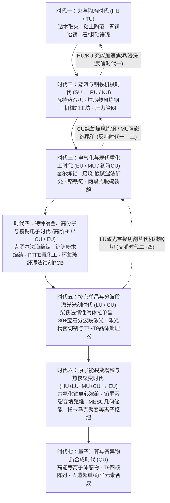

# GT6CE 科技演进路线（科技树设计）

模组的科技树即一部微缩的**人类科技与工业发展史**。科技的推进不靠抽象的“电压等级加零”，而是由**新能量形态的掌控 → 新材料范式的突破 → 新加工精度的诞生 → 对旧产线的技术反哺**驱动，分为七个有机衔接的时代。

## 核心设计原则

1. **每一次时代跃迁 = 新能量形态的掌控 + 新材料范式的突破 + 新加工精度的诞生**。
2. **早期即引入轻量级多能量谜题**：不把多能量协同锁死在大后期，从第一、二时代的坩埚（`HU` 控温 + `KU` 活塞鼓风 + `CU`/水冷快凝）和热法搅拌（`HU` + `RU`）起就引入多能种配合。
3. **高阶技术反哺早期产线（纵向升级红利）**：每进入一个新时代，新解锁的能量（如 `EU`、`MU`、`CU`、`LU`）与新材料（如纯氧、无机酸碱、分波段激光、催化剂）都能回过头来改造前期的炼钢、焦炭、橡胶、选矿与基础零件产线，实现更高产率、更低损耗或更高并行，杜绝“早期机器堆数量走到通关”。

## 七大时代演进总览

| 时代 | 历史原型 | 主导能量与协同 | 标志性材料突破 | 核心工艺、多能量谜题与对早期产线的技术反哺 |
| --- | --- | --- | --- | --- |
| **一、火与陶冶时代** | 钻木取火、新石器制陶、青铜泥范铸造 | **原始火源与初阶热能（`HU`）** + 基础时间能（`TU`） | 燧石、耐火粘土、铜、锡、**青铜**、铅、黄铜、生铁/熟铁 | **手作与热冶启蒙**：地表石子地质勘探、精工宝石采矿工具、烧制陶坩埚与 `5×5` 像素模具雕刻浇铸、石砧/青铜砧锤锻；焦炉与浸洗/凝结在无外部供能时按基础 `TU` 自然推进保底。 |
| **二、蒸汽与钢铁机械时代** | 第一次工业革命：瓦特蒸汽机、坩埚/转炉炼钢、机械工坊 | **蒸汽（`SU`）→ 旋转能（`RU`）与活塞动能（`KU`）**；初阶 **`HU + KU` 协同** | 焦炭、**钢**、**殷钢**、锻铁、橡胶、防腐木、初阶铬（火法过渡） | **机械直驱与早期多能量谜题**：锅炉与蒸汽轮机/引擎通过确定性传动轴网与齿轮箱直接驱动破碎（`KU`）、车床/轧机/洗矿（`RU`）、液化/挤压（`HU`）；**前期多能量谜题**：坩埚“底部 `HU` 控温 + 侧面 `KU` 活塞定量鼓风炼钢 + 快速冷却定型”；**技术反哺**：向焦炉/浸洗槽/凝结器注入 `HU/KU` 大幅加速早期 `TU` 工序。 |
| **三、电气化与现代重化工时代** | 第二次工业革命：电磁感应、霍尔-埃鲁法炼铝、湿法冶金、石油分馏 | **电能（`EU`）→ 磁能（`MU`）与初阶冷能（`CU`）**；**`HU + RU/EU` 协同** | **铝**、**不锈钢**、铬、镍、锰、钒钢、硅、聚乙烯（PE）、聚氯乙烯（PVC） | **电化学、湿法矿处与两段式石化**：`EU` 解锁非电不可的电解与远距输电（消除低压线损凑数痛点）；焙烧炉打通“氧化焙烧 → 酸浸/碱熔 → 电解/结晶”双轨矿处与铬铁矿正统链；蒸馏塔含硫馏分 → 净油器加氢脱硫 + 裂解塔（`HU`）回流；**技术反哺**：用强磁选（`MU`）从早期铁/铜尾矿中提取贵金属与稀土，用 `CU` 空分纯氧替代空气鼓风使早期炼钢与焙烧效率倍增。 |
| **四、特种冶金、高分子与覆铜电子时代** | 20 世纪中叶航空难熔冶金、氟化工与印刷电路板（PCB）革命 | **高阶 `HU / EU / CU` 多能种协同** | **钛**、**钨**、**碳化钨**、钽、铌、铂族、**特氟龙（PTFE）**、**环氧玻纤**、焊锡合金 | **克罗尔法、粉末烧结与湿法蚀刻电子**：四氯化钛还原制钛；钨/钽/铌开辟“还原→压块→高温烧结”粉末冶金路线；氢氟酸与 PTFE 耐蚀设备支撑高危化工；构建“酚醛 → 环氧玻纤 → 多层板 + 电蚀刻液”垂直电子链（T4~T6），解锁具备**成套批次投料与储物桶直连**特色的**物流核心**；**大小坩埚分化**（大坩埚大宗量产 vs 小坩埚低热惯量精密特种配料）。 |
| **五、掺杂单晶与分波段激光光刻时代** | 20 世纪下半叶信息与光子革命：柴氏法拉单晶、梅曼红宝石激光、光刻封装 | **光/激光能（`LU`）** + 深冷保护气（`CU`） | **掺杂单晶硅**、**人造各色刚玉/石榴石/绿柱石激光晶体**、超导材料、锂系高能电池 | **单晶生长、宝石光学与微电子装配**：在结晶坩埚（及大型结晶坩埚）中通入惰性气体拉制掺杂单晶；将 80+ 种宝石加工为分波段激光器谐振腔与透镜；用 **LU 激光切割机**与**电路装配机**制造晶圆与 **T7~T9 晶体处理器单元**；**技术反哺**：用 `LU` 激光精密切割替代传统机械锯切，使早期板材/晶圆/零件加工实现零损耗翻倍产出。 |
| **六、原子能裂变增殖与热核聚变时代** | 当代人类能源巅峰：气体离心浓缩、增殖反应堆、PUREX 后处理、托卡马克磁约束聚变 | **裂变核热（`HU`）+ 激光点火（`LU`）+ 超导磁约束（`MU + CU`）→ 终局电网（`EU`）** | 核级锆/铪、铍、锂-6、重水/氚水、钍熔盐、铀-235/233、钚-239、镅、氘、氚、氦-3、高能等离子体 | **核化工闭环与多能量终局合流**：六氟化铀离心浓缩 → 铅壁物理屏蔽下的 `1x1`/`2x2` 裂变堆（11 种慢化冷却剂调控中子通量，驱动高档热交换器与 **MESU 几何多方块巨型储能**）→ 乏燃料后处理提取氚/钚/镅/钴-60；最终集结 **T9 晶体主控 + 液氦超导磁体（`CU+MU`）+ 分波段宝石激光点火（`LU`）+ 裂变增殖同位素**启动**聚变反应堆枢纽**，驱动等离子涡轮与终局材料合成。 |
| **七、量子计算与奇异物质合成时代** | 前沿物理探索：重离子合成超重元素、单分子操纵与量子计算 | **激光能（`LU`）→ 量子能（`QU`）** | 人造超重/奇异元素、同位素嬗变产物、量子态材料、永恒催化剂 | **非破坏性终局延伸**：以聚变等离子体、稀有同位素与 T9 四核处理器阵列为基础，通过分子扫描仪、质量制造机与复制机（`QU`）定向合成**自然界不存在的人造超重/奇异元素与高阶量子材料**（不无脑复制大宗基础矿产，确保前六代工业产线终身保值）。 |

---

## 各时代详细设计

### 时代一：火与陶冶时代（石器 → 陶器 → 青铜时代）

- **人类历史映射**：旧石器打制石器 → 新石器钻木取火与制陶术 → 青铜时代泥范铸造与块炼铁。
- **主导能量**：**原始火源与直接热能（`HU`）** + **基础时间能（`TU` 自然推进保底）**。
- **核心材料**：燧石、耐火粘土、铜、锡、**青铜（Bronze）**、铅、黄铜、锌、早期熟铁/生铁。
- **核心玩法与机制**：
  1. **地表地质勘探与正向采矿**：观察反映下方岩层基底的地表散落石子（[#194](https://github.com/GregTech6CE/GregTech6/issues/194)），使用前期精工采矿工具直接采出高品质 GT 宝石与粗矿（已统合原版 `raw_iron`/`raw_copper`/`raw_gold`）。
  2. **手作陶艺与 `5×5` 像素模具雕刻**：手工捏制粘土模具、粘土碗、陶坩埚，烧制后用凿子在模具上进行 `5×5` 像素位掩码雕刻。
  3. **坩埚初体验与物理砧锻**：砖/铜燃烧室顶置陶坩埚，按配比熔炼铜与锡浇铸青铜；在石砧/青铜砧上用锤子敲击加工板材、杆件与工具头（工具头损坏保留断头主体，支持换头修复）。
  4. **无压起步保底**：焦炉（炼焦炭）、木桶浸洗与橡胶凝结在没有外部能量注入时，按基础 `TU` 自然推进完成过渡。

### 时代二：蒸汽与钢铁机械时代（第一次工业革命）

- **人类历史映射**：18 世纪瓦特蒸汽机、焦炭炼铁、坩埚/贝塞麦转炉炼钢、水力与蒸汽机械工坊。
- **主导能量**：**热能（`HU`）→ 蒸汽（`SU`）→ 旋转机械能（`RU`）与往复活塞动能（`KU`）**。
- **核心材料**：焦炭、**钢（Steel）**、**殷钢（Invar）**、锻铁、防腐处理木、硫化橡胶、红石合金、初阶铬（火法过渡）。
- **核心玩法与机制**：
  1. **蒸汽机械直驱工坊**：建造蒸汽锅炉（原生遥测直接显示半满输出线、水垢状态与安全阈值），驱动蒸汽轮机（产 `RU`）与蒸汽引擎（产 `KU`）；用 `KU` 驱动破碎机/压机/筛粉机，用 `RU` 驱动车床/轧机/拉线机/洗矿机/搅拌机，用 `HU` 驱动 1 档熔化器、初阶液化炉与挤压机。
  2. **前期轻量级多能量谜题**：
     - **坩埚 `HU + KU` 协同炼钢**：底部燃烧室提供 `HU` 将铁升温至熔点以上，侧面蒸汽引擎驱动活塞注入 `KU`（鼓入空气氧化脱碳或助燃升温），配合龙头与模具对称红石控制（常红石/脉冲）实现首套半自动炼钢浇铸线；
     - **前期火法提铬过渡**：提供无需复杂湿法化工、产量可预期且可自动化的前期低效火法提铬路线，平稳解锁初级耐蚀器件。
  3. **技术升级红利（反哺时代一）**：
     - 为时代一的 `TU` 机器（焦炉、浸洗槽、凝结器、高压釜）接入 `HU` / `KU` 能量，使其脱离漫长的自然读条，获得数倍加工提速；
     - 用自动锤（`KU`）接管金属砧上的手动打铁，用合并了 `9x 小撮矿 → 1x 粉` 的洗矿线大幅提升矿石副产率。

### 时代三：电气化与现代重化工时代（第二次工业革命）

- **人类历史映射**：19 世纪末法拉第电磁学、西门子发电机、霍尔-埃鲁法电解铝、接触法硫酸、拜耳法/湿法冶金、现代石油分馏与加氢脱硫。
- **主导能量**：**电能（`EU`）→ 磁能（`MU`）与初阶冷能（`CU`）**；**`HU + RU/EU` 催化协同**。
- **核心材料**：**铝（Aluminium）**、**不锈钢（Stainless Steel）**、铬、镍、锰、钒钢、工业硅、聚乙烯（PE）、聚氯乙烯（PVC）、合成气（$\text{CO} + \text{H}_2$）。
- **核心玩法与机制**：
  1. **非电不可的电化学突破**：将旋转能通过发电机转化为 `EU`，用于人类历史上真正必须用电的环节——**氧化铝熔盐电解制铝、氯碱工业（电解食盐水制氯气/烧碱/氢气）、酸碱化合物电解分离**。
  2. **焙烧—湿法双轨冶金**：
     - 焙烧炉（Roaster）及**大型焙烧炉**将硫化物矿氧化焙烧产出金属氧化物与 $\text{SO}_2$（制备硫酸），并接通下半截**“碱熔/酸浸 → 结晶/电解/还原”**湿法提纯链；
     - **铬铁矿湿法主线**（铬铁矿 + 纯碱 + 氧气高温搅拌焙烧 → 铬酸钠 → 硫酸酸化重铬酸钠 → 碳还原氧化铬 → 铝热/电解得高产率铬，纯碱循环再生）。
  3. **油品两段式脱硫与裂解回流**：
     - 原油经蒸馏塔（突破 1024 HU 上限）产出含硫馏分 → 进入**净油器**（加氢脱硫产清洁燃油与 $\text{H}_2\text{S}$，独立氢气槽防死锁）→ 重油/石脑油/瓦斯油进入**裂解塔（`HU`）**进行蒸汽裂解（产乙烯/丙烯）或加氢裂解，形成精炼回流闭环。
  4. **技术升级红利（反哺时代一、二）**：
     - **纯氧助燃与氧化（`CU` 反哺 `HU`）**：利用初阶深冷分离出的液氧/纯氧替代普通空气通入坩埚与焙烧炉，大幅缩短炼钢与焙烧耗时、降低燃料消耗；
     - **强磁选提纯（`MU` 反哺选矿）**：用高档电磁铁驱动磁选机，从前期积累的铁/铜/石英尾矿与伴生矿粉中分离出稀土、铂族泥、金红石与钒钛伴生矿。

### 时代四：特种冶金、高分子与覆铜电子时代（20 世纪中叶航空与电子革命）

- **人类历史映射**：克罗尔法海绵钛、难熔金属（钨/钽/铌）粉末烧结冶金、特氟龙（PTFE）氟化工、环氧玻纤覆铜板（FR-4 PCB）湿法蚀刻。
- **主导能量**：**高阶 `HU / EU / CU` 多能种协同** + **高阶 `RU`（4096+ RU 大型液体燃料燃气轮机）**。
- **核心材料**：**钛（Titanium）**、**钨（Tungsten）**、**碳化钨**、钼、钽、铌、铂族六金属、**聚四氟乙烯（PTFE / 特氟龙）**、**环氧树脂与玻璃纤维**、焊锡合金。
- **核心玩法与机制**：
  1. **克罗尔法提钛与难熔金属粉末冶金**：
     - 钛铁矿/金红石 + 氯气 + 碳 → 四氯化钛 → 镁还原得海绵钛（氯化镁电解循环）；
     - 钨、钽、铌及特种碳化物开辟**“化学还原 → 粉末压块 → 高温烧结”**非液态成型路线，同时提供**高温催化搅拌机（`HU` 加热 + `RU/EU` 搅拌）**。
  2. **大小坩埚后期特色分化**：
     - **大坩埚（多方块）**配合高档大型热交换器与可存储显热工质（熔盐/热冷却液），专精钢铁、不锈钢、钛合金的大宗高速批量生产；
     - **小坩埚（单方块）**凭借低热惯量、极速升降温与多腔同步浇铸模具（[#355](https://github.com/GregTech6CE/GregTech6/issues/355)），专精少量高价值贵金属、超导前驱体与特种合金的精确自动化配料。
  3. **工程高分子与覆铜湿法蚀刻电子链**：
     - 萤石制氢氟酸合成 **PTFE（特氟龙）**，专门制造耐强酸/氟化物腐蚀的管道、储罐与反应釜衬里（支撑钽铌氟络合物分离与下一代六氟化铀浓缩）；
     - 苯与丙烯经异丙苯法制苯酚与丙酮 → 双酚 A + 环氧氯丙烷 + 玻璃纤维 → **环氧玻纤覆铜板与多层环氧板**，配合**电蚀刻液（$\text{HCl} + \text{H}_2\text{O}_2$ / $\text{FeCl}_3$）**与焊锡合金制造 T4~T6 精密电路，支撑多方块**物流核心**与全厂按配方定量限流自动化。

### 时代五：掺杂单晶与分波段激光光刻时代（20 世纪下半叶信息与光子革命）

- **人类历史映射**：柴可拉斯基法（Czochralski）单晶生长、红宝石/YAG/准分子分波段激光器、晶圆激光切割与微电子光刻封装。
- **主导能量**：**光/激光能（`LU`）** + **深冷能（`CU` 惰性气体空分与超导冷却）**。
- **核心材料**：**掺杂单晶硅**、**人造红宝石/各色蓝宝石/石榴石/绿柱石光学单晶**、铌钛/钇钡铜氧超导材料、锂钴/锂锰/六氟磷酸锂高能电池材料。
- **核心玩法与机制**：
  1. **结晶坩埚掺杂单晶生长**：在结晶坩埚与新增的**大型结晶坩埚**中，通入深冷蒸馏空气/末地空气所得的惰性保护气（氦/氖/氩/氪/氙），将高纯硅或氧化铝与微量过渡金属掺杂剂（铬/钛/钒/铁/镁）共熔拉制完美单晶棒。
  2. **80+ 种宝石的光学赋能（分波段激光体系）**：不同色系与种类的单晶宝石具备不同的光学倍频与谐振特性，作为核心光学元件组装不同波段与功率等级的激光器（`LU`）。
  3. **激光精加工与 T7~T9 晶体处理器**：
     - 新增 **LU 激光切割机**与 **LU 电路装配机**，将单晶棒切割为晶圆与晶体基板，制造 **T7 晶体插座 → T8 晶体处理器 → T9 四核/逻辑/控制处理器单元**；
  4. **技术升级红利（反哺前四代产线）**：
     - **激光无损精密切割（`LU` 反哺机械加工）**：用 `LU` 激光切割机替代早期圆锯/切割机处理金属板、杆、螺栓与宝石板，彻底消除切屑损耗并大幅提升产出比；
     - **三段式深度选矿全开**：结合大型挤出机、大型干燥机与三段式选矿线，将原矿利用率推向极限。

### 时代六：原子能裂变增殖与热核聚变时代（当代人类能源巅峰与本体终局主线）

- **人类历史映射**：气体离心浓缩铀-235、轻水/重水/钠冷快堆/钍基熔盐增殖堆、PUREX 乏燃料后处理、托卡马克（ITER）超导磁约束 + 高能激光点火可控核聚变。
- **主导能量**：**裂变核热（`HU`）+ 激光点火（`LU`）+ 超导磁约束（`MU + CU`）→ 终局大电网（`EU`）**。
- **核心材料**：核级锆/铪、镉铟银控制棒、铍反射/增殖棒、锂-6、重水/半重水/氚水、四氟化铀/六氟化铀、钍盐、铀-235/233、钚-239/241、镅-241、氘、氚、氦-3、高能等离子体。
- **核心玩法与终局工程谜题**：
  1. **核氟化工与气体离心浓缩**：利用时代四的 PTFE 耐氟化氢体系生产四氟化铀与**六氟化铀（$\text{UF}_6$）**，经离心机阵列分离浓缩铀-235 与贫铀-238。
  2. **物理辐射屏蔽下的裂变增殖工程**：
     - 从 `1x1` 入门核核心到 `2x2` 阵列核堆，在**致密铅壁/防辐射屏蔽室**（实装空间辐射衰减与方块物理屏蔽）内，运用 **11 种慢化/冷却剂（蒸馏水、重水、熔钠、熔锡、氦气、钍熔盐等）** 调控中子通量；
     - 一方面通过高档大型热交换器驱动轮机发电，存入由电极间距与电池芯几何排布决定电压/容量的 **MESU 多方块巨型储能**；
     - 另一方面将钍-232 增殖为铀-233、铀-238 增殖为钚-239、锂-6 增殖为**氚（Tritium）**，并通过乏燃料后处理提取镅、钴-60 与氦-3。
  3. **可控核聚变终局枢纽（多能量分阶段协同大考）**：
     - 集结 **T8/T9 晶体处理器主控 + 大型电磁感应预热（`HU`）+ 液氦冷却超导磁约束线圈（`CU + MU`）+ 分波段宝石高能激光阵列点火（`LU`）+ 裂变增殖同位素燃料**，完成带容错窗口与清晰状态遥测的多能量协同聚变反应；
     - 聚变堆作为**能量与高能物质枢纽**，输出高能等离子体驱动**等离子涡轮**发电，并利用高能等离子体与中子通量合成终局特种材料。

### 时代七：量子计算与奇异物质合成时代（人类前沿物理探索与终局延伸）

- **人类历史映射**：重离子加速器人工合成超重元素、量子纠缠态操控与量子计算。
- **主导能量**：**激光能（`LU`）→ 量子激光器 → 量子能（`QU`）**。
- **核心材料**：人造超重/奇异元素、同位素嬗变产物、量子态材料、永恒催化剂。
- **核心玩法与边界**：
  - 将 **T9 四核处理器阵列**与**分子扫描仪、质量制造机、物质复制机（`QU`）**结合，以聚变产出的高能等离子体与稀有同位素为底物，定向合成**自然界不存在的人造超重元素与奇异量子材料**；
  - 严格限制复制机无脑复制铁、铜、钛等常规大宗工业矿产，使玩家从时代一到时代六亲手搭建的每一座矿处、冶金、石化与核能工厂在终局依然满负荷运转、终身保值。
