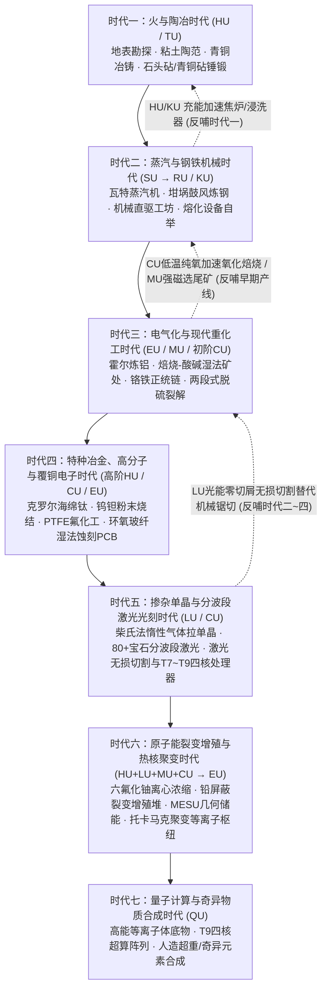

# GT6CE 科技演进路线

> **远景锚点说明**：本文档定义 GT6CE 长期演进的科技树主线，作为各版本玩法、材料闭环与产线设计的对齐基准。其中时代一至时代二及热工冶金主线已在 `v1.0 ~ v1.4` 逐步推进；时代三后半段至时代七的深度化工、覆铜电子、分波段激光、核能增殖与量子合成扩展内容目前收纳于 [`future-ideas.md`](../roadmap/future-ideas.md)，随版本迭代分批落地。

GT6CE 的科技树是一部微缩的**人类工业文明演进史**。科技的推进不靠单调的“电压等级加零”，而是由**新能量形态的掌控 → 新材料范式的突破 → 新加工精度的诞生 → 对早期产线的技术反哺**驱动，构成七个环环相扣、层层自举的工业时代。

## 核心设计原则

1. **时代跃迁三要素**：每一次跨越时代，都对应着**一种新物理能量的驯服、一类新材料体系的破局、一套新制造精度的确立**。
2. **早期即引入轻量级多能量谜题**：多能量协同并非大后期的专属门槛。从第一、二时代的坩埚冶炼（底部 `HU` 热能控温 + 侧面 `KU` 动能鼓风 + 水冷/`CU` 低温能快速凝固定型）与热法反应起，玩家便在空间布局中体验多能种配合的乐趣。
3. **高阶技术反哺早期产线（纵向升级红利）**：每迈入一个新时代，新解锁的能量（`EU`、`MU`、`CU`、`LU`）与新工业介质（低温纯氧、无机酸碱、合成气、分波段激光、特种催化剂）都能回头改造早期的焦煤、炼钢、选矿与零件加工线，带来更高收率、更低损耗或更高并行，彻底杜绝“初级机器堆数量走到通关”。

## 七大时代演进总览

| 时代 | 历史原型 | 主导能量与协同 | 标志性材料突破 | 核心工艺、工程谜题与纵向技术反哺 |
| --- | --- | --- | --- | --- |
| **一、火与陶冶时代** | 钻木取火、新石器制陶、青铜泥范铸造 | **原始火源与初阶热能（`HU`）** + 时间（`TU`） | 燧石、耐火粘土、铜、锡、**青铜**、铅、黄铜、生铁/锻铁 | **手作勘探与热冶启蒙**：观察地表散落岩石勘探矿脉，烧制陶坩埚与 `5×5` 像素掩码模具浇铸青铜，在石头砧/青铜砧上锤锻零件；焦炉、浸洗器与凝结器在无外接供能时按基础 `TU` 自然推进保底。 |
| **二、蒸汽与钢铁机械时代** | 第一次工业革命：瓦特蒸汽机、坩埚鼓风炼钢、机械工坊 | **蒸汽（`SU`）→ 旋转能（`RU`）与动能（`KU`）**；初阶 **`HU + KU` 协同** | 焦煤、**钢**、**殷钢**、锻铁、硫化橡胶、防腐木、初阶铬（火法过渡） | **机械直驱与早期多能量谜题**：锅炉与蒸汽轮机/引擎经确定性传动轴网与齿轮箱直驱破碎/压缩/压力成型/筛选（`KU`）、车床/辊压/线缆轧制/洗矿（`RU`）、熔化/液化/压模（`HU`）；**坩埚 `HU + KU` 鼓风炼钢**；**反哺**：向焦炉/浸洗器/凝结器注入 `HU`/`KU` 大幅提速。 |
| **三、电气化与现代重化工时代** | 第二次工业革命：电磁感应、霍尔-埃鲁法炼铝、湿法冶金、石油分馏 | **电能（`EU`）→ 磁力能（`MU`）与初阶低温能（`CU`）**；**`HU + RU/EU` 协同** | **铝**、**不锈钢**、铬、镍、锰、钒钢、工业硅、聚乙烯（PE）、聚氯乙烯（PVC）、合成气 | **电化学、双轨矿处与两段式石化**：`EU` 专攻熔盐电解铝与氯碱工业；焙烧炉打通“氧化焙烧 → 酸浸/碱熔 → 结晶/电解”双轨冶金与铬铁矿正统链；蒸馏塔含硫馏分经加氢脱硫与蒸汽/催化裂解器回流；**反哺**：`MU` 强磁选淘洗尾矿贵金属，`CU` 低温纯氧加速氧化焙烧。 |
| **四、特种冶金、高分子与覆铜电子时代** | 20 世纪中叶航空难熔冶金、氟化工与印刷电路板（PCB）革命 | **高阶 `HU / EU / CU` 多能种协同** + 大型燃气轮机（`RU`） | **钛**、**钨**、**碳化钨**、钽、铌、铂族、**聚四氟乙烯（PTFE）**、**环氧玻纤**、焊锡合金 | **克罗尔法、粉末烧结与湿法蚀刻电子**：四氯化钛镁热还原制钛；钨/钽/铌开辟“化学还原 → 粉末压块 → 高温烧结”非液态成型路线，自举制造碳化钨顶档液化炉；PTFE 氟化工抗蚀；构建“酚醛 → 环氧玻纤覆铜板 + 电蚀刻液”垂直电子链（T4~T6），点亮**物流核心**；**大小坩埚双轨分化**。 |
| **五、掺杂单晶与分波段激光光刻时代** | 20 世纪下半叶信息与光子革命：柴氏法拉单晶、红宝石激光、光刻封装 | **光能（`LU`）** + 低温保护气（`CU`） | **掺杂单晶硅**、**人造刚玉/石榴子石/绿柱石激光晶体**、超导材料、锂系高能电池 | **单晶生长、宝石光学与微电子装配**：在结晶器中通入高纯惰性气体拉制掺杂单晶；赋予 80+ 种宝石分波段激光谐振腔与透镜用途；用 **LU 激光切割机**与**电路装配机**制造晶圆与 **T7~T9 四核处理器**；**反哺**：`LU` 激光实现板材/晶圆零损耗无损精密切割。 |
| **六、原子能裂变增殖与热核聚变时代** | 当代人类能源巅峰：气体离心浓缩、增殖反应堆、PUREX 后处理、磁约束聚变 | **裂变核热（`HU`）+ 光能点火（`LU`）+ 超导磁约束（`MU + CU`）→ 终局电网（`EU`）** | 核级锆/铪、铍、锂-6、重水/超重水、钍盐、铀-235/233、钚-239、镅、硅岩金属、氘、氚、氦-3、高能等离子体 | **核化工闭环与多能量终局合流**：六氟化铀离心浓缩 → 铅壁物理屏蔽下的 `1x1`/`2x2` 核反应堆（11 种慢化冷却剂调控中子通量，驱动大型热交换器与 **MESU 几何多方块巨型储能**）→ 乏燃料后处理提取氚/钚/镅/钴-60；最终集结 **T9 四核主控 + 超导磁体（`CU+MU`）+ 分波段光能点火（`LU`）**启动**聚变反应堆枢纽**。 |
| **七、量子计算与奇异物质合成时代** | 前沿物理探索：重离子合成超重元素、单分子操纵与量子计算 | **光能（`LU`）→ 量子能（`QU`）** | 人造超重/奇异元素、同位素嬗变产物、量子态材料、永恒催化剂 | **非破坏性终局延伸**：以聚变高能等离子体、稀有同位素与 T9 四核阵列为底物，经分子扫描仪、物质制造器与物质复制器（`QU`）定向合成**自然界不存在的人造超重/奇异元素与量子材料**（严禁无脑复制常规大宗矿产，确保前六代工厂终身保值）。 |

---

## 七大工业时代详述

### 时代一：火与陶冶时代（石器 → 陶器 → 青铜时代）

- **历史长河的起点**：从旧石器时代的打制燧石，到新石器时代捏土成陶、引火入炉，再到青铜时代泥范铸造与块炼锻铁的文明曙光。
- **主导能量**：**原始火源与初阶热能（`HU`）** + **时间（`TU` 自然推进保底）**。
- **标志性材料**：燧石、耐火粘土、铜、锡、**青铜（Bronze）**、铅、黄铜、锌、早期生铁与锻铁。
- **核心体验与工业脉络**：
  1. **读懂大地的语言（地表勘探与正向采矿）**：荒野地表的散落石块直接按其内含岩石与矿物材质呈现外观（[#194](https://github.com/GregTech6CE/GregTech6/issues/194)），指引玩家锁定地下深处的锡石大理石层与原生铜矿脉；配合前期精工采矿工具，无需繁琐玄学即可采出高品质原生宝石与矿石原矿（铁、铜、金矿石原矿已统一归并至 1.17+ 原版 `raw_iron`、`raw_copper`、`raw_gold`）。
  2. **陶范雕刻与坩埚热力学启蒙**：GT6 的第一条铁律在此立下——**铁、锻铁、钢、钛、钨绝不可在普通熔炉中烧炼（强行烧制只会化作废料）**，而制造任何熔化机器又恰恰需要先拥有铁。破局的唯一钥匙是亲手捏制粘土碗、陶坩埚与粘土模具：烧制硬化后，手持凿子在模具表面进行 `5×5`（25 位掩码）像素级空腔雕刻；将陶坩埚架设于砖砌或纯铜燃烧室之上，遵循“每 `100 kg` 物料升温 `1 K` 消耗 `1 HU`、停止供热后每 `10 tick` 向环境温度回落 `1 K`”的真实热力学规则，按配比熔化铜与锡，赶在金属液凝固前开启坩埚浇铸口，任金属液经坩埚浇铸道注入模具。
  3. **砧上锤锻与模块化工具**：冷却脱模的青铜锭与锻铁锭被送上双槽石头砧或青铜砧，在一锤一锻的物理敲击中延展为板材、杆件、环件与工具头；即使工具头在开拓中磨损断裂，保留下来的“断头主体”也可随时换上新工具头重获新生。
  4. **从容不迫的 `TU` 起步保底**：砌筑多方块焦炉干馏原煤制取焦煤（`CoalCoke`）与杂酚油（基础耗时约 `3,600 tick`），或在木桶浸洗器、凝结器中处理木材与生胶；在尚未拥有外部动力源时，它们依靠时间（`TU`）静默推进，为文明的火种守住平稳过渡的底线。

### 时代二：蒸汽与钢铁机械时代（第一次工业革命）

- **历史长河的跃迁**：18 世纪瓦特改良蒸汽机、焦炭高炉与贝塞麦转炉炼钢相继问世，人类首次摆脱肌肉与自然水力的束缚，用齿轮、连杆与蒸汽管道构筑起轰鸣的机械工坊。
- **主导能量**：**热能（`HU`）→ 蒸汽（`SU`）→ 旋转能（`RU`）与动能（`KU`）**。
- **标志性材料**：焦煤、**钢（Steel）**、**殷钢（Invar）**、锻铁、防腐处理木、硫化橡胶、红石合金、初阶铬（火法过渡）。
- **核心体验与工业脉络**：
  1. **蒸汽轰鸣与确定性机械传动**：点燃固体、液体或流化床燃烧室（`16 ~ 1024 HU/t`），在蒸汽锅炉中以 `1 L 水 + 80 HU → 160 L 蒸汽` 的经典热工比产生高压蒸汽（原生遥测直接标示 50% 半满输出线、水垢衰减与干烧风险）；蒸汽分流推动蒸汽轮机产出旋转能（`RU`）、推动蒸汽引擎产出动能（`KU`）。经由同轴聚合、状态持久化的直线传动轴与多源安全合流、均匀分流的齿轮箱，动力被精准输送至每一台工坊母机——用 `KU` 驱动破碎机、压缩机、压力成型机与筛选机，用 `RU` 驱动车床、辊压机、线缆轧制机、洗矿厂与搅拌机，用 `HU` 直驱 1 档不锈钢熔化器（`32 HU/t`）、殷钢/钢壳液化炉（`32 / 128 HU/t`）与压模器。
  2. **前期轻量级多能量谜题——坩埚 `HU + KU` 协同炼钢**：
     - 炼钢不再是放进高炉傻等进度条，而是前中期极具仪式感的空间协同工程：底部燃烧室持续注入 `HU` 将铁块加热跨越 `1811 K` 熔点，当原生遥测给出“完全熔化态就绪”信号时，侧面蒸汽引擎驱动活塞向坩埚注入 `KU`（鼓入空气氧化脱碳），随后通过水冷或初阶低温能（`CU`）快速降温定型，并在统一了“常红石 / 脉冲”逻辑的坩埚浇铸口与模具配合下，完成首条半自动钢铁浇铸线；
     - 同步提供无需复杂湿法化工、产量可预期且可自动化的**前期低效火法提铬过渡路线**，帮助玩家平稳跨越不锈钢与耐蚀组件的初阶门槛。
  3. **工业自举与跨代反哺（反哺时代一）**：
     - 凭借首批浇铸出的钢与殷钢，玩家得以造出液化炉解锁“熔融铜 → 退火铜、熔融铁 → 锻铁”的液相精炼；
     - 向时代一的 `TU` 设备（焦炉、浸洗器、凝结器）接入 `HU` 或 `KU` 能量，使其彻底摆脱漫长的自然读条实现数倍提速；用自动锤（`KU`）接管金属砧上的手工锻打，并用合并了 `9x 小撮粉碎矿石 → 1x 矿粉` 的大型洗矿厂解除副产槽位锁死，迎来矿石处理吞吐量的第一次爆发。

### 时代三：电气化与现代重化工时代（第二次工业革命）

- **历史长河的跃迁**：19 世纪末法拉第电磁感应、西门子发电机、霍尔-埃鲁法熔盐电解铝、接触法制硫酸与现代石油分馏相继成熟，工业的重心从宏观机械转向电子流动与分子重组的化学工业。
- **主导能量**：**电能（`EU`）→ 磁力能（`MU`）与初阶低温能（`CU`）**；**`HU + RU/EU` 催化协同**。
- **标志性材料**：**铝（Aluminium）**、**不锈钢（Stainless Steel）**、铬、镍、锰、钒钢、工业硅、聚乙烯（PE）、聚氯乙烯（PVC）、合成气（$\text{CO} + \text{H}_2$）。
- **核心体验与工业脉络**：
  1. **好钢用在刀刃上的电化学突破**：在 GT6CE 中，跨能种转换天然伴随着物理折损（例如 `EU → HU → 蒸汽 → RU → EU` 的往返效率仅约 `23%`），这决定了电能（`EU`）绝非取代一切的万能插座，而是专精于远距离低损输电（彻底消除低压线损凑数痛点）与**非电不可的电化学工程**——氧化铝冰晶石熔盐电解制铝、氯碱工业电解食盐水联产氯气/烧碱/氢气，以及各类酸碱盐的电解分离。
  2. **焙烧—湿法双轨冶金与铬铁矿正统链**：
     - 殷钢与钢壳焙烧炉（`Roasting Oven`）及规划新增的**大型焙烧炉**将黄铁矿石、闪锌矿石、方铅矿石、铜铂矿石、辉钼矿石等 26 类硫化物与金属矿物氧化焙烧，副产 $\text{SO}_2$ 制备工业之母硫酸，并接通下半截**“碱熔/酸浸 → 结晶/电解/还原”**的完整湿法提纯链；
     - 废除“铬铁矿坩埚直熔/直电解出铬”的失真捷径，确立现代工业正统的**铬铁矿湿法主线**：铬铁矿（$\text{FeCr}_2\text{O}_4$）与纯碱、氧气高温焙烧生成铬酸钠 → 硫酸酸化转化为重铬酸钠 → 碳热还原得三氧化二铬 → 铝热或电解提纯金属铬，副产硫酸钠经循环再生归还纯碱，并与赤铁矿盐酸浸出、氟化氢水合共同构成严丝合缝的酸碱物料闭环。
  3. **两段式石化脱硫、裂解回流与合成气网络**：
     - 地下开采的轻/重原油与灵魂沙油进入多级**蒸馏塔**（突破 `1024 HU` 输入上限）分馏出含硫瓦斯油、石脑油、煤油、柴油与重油 → 经规划新增的**净油器**加氢脱硫（内置独立氢气槽防止批次抽干死锁）产出清洁燃料并回收硫化氢（$\text{H}_2\text{S}$）制酸 → 馏分油进入**蒸汽裂解器**与铂催化的**催化裂解器**（及规划中的多方块**裂解塔**）转化为乙烯、丙烯与轻烃，在搅拌机中经 $\text{TiCl}_4-\text{MgCl}_2$ 齐格勒-纳塔催化聚合为聚乙烯（PE）与聚氯乙烯（PVC）；
     - 煤气化、天然气重整与生物质气化汇入**合成气（$\text{CO} + \text{H}_2$）**主干网，串联起哈伯法高压催化合成氨（$\text{NH}_3$）与铂铑催化氧化制硝酸产线。
  4. **纵向技术反哺（反哺时代一、二）**：
     - **低温纯氧强化焙烧（`CU` 反哺 `HU`）**：由于热能（`HU`）没有传输管道、只能面对面注入，玩家可在冶金车间旁就地部署**低温蒸馏塔（`CU`）**分离液态空气，将高纯氧气通入焙烧炉与化工氧化反应器，大幅压缩氧化耗时并消除氮气占槽损耗（前中期炼钢依然由坩埚 `HU + KU` 独占承载）；
     - **强磁选淘洗尾矿（`MU` 反哺选矿）**：用高档电磁铁驱动磁选机与电磁偏振器，从早期堆积的铁、铜、石英尾矿与基岩粉中精准分离出血石（`Adamantine`）、稀土、铂族泥与钒钛伴生矿。

### 时代四：特种冶金、高分子与覆铜电子时代（20 世纪中叶航空与电子革命）

- **历史长河的跃迁**：20 世纪中叶航空喷气时代的降临催生了克罗尔法海绵钛与难熔金属粉末冶金；聚四氟乙烯（PTFE）驯服了极度狂暴的氟化学；而环氧玻纤覆铜板（FR-4 PCB）与湿法蚀刻工艺则奠定了现代电子工业的基石。
- **主导能量**：**高阶 `HU / EU / CU` 多能种协同** + **高阶 `RU`（`4096+ RU` 大型液体燃料燃气轮机）**。
- **标志性材料**：**钛（Titanium）**、**钨（Tungsten）**、**碳化钨**、钼、钽、铌、铂族六金属、**聚四氟乙烯（PTFE / 特氟龙）**、**环氧树脂与玻璃纤维**、特种焊锡合金。
- **核心体验与工业脉络**：
  1. **克罗尔法海绵钛与难熔金属粉末烧结（高阶自举）**：
     - 钛铁矿与金红石在氯气与碳的作用下生成四氯化钛（$\text{TiCl}_4$），经金属镁热还原产出海绵钛，副产氯化镁电解再生镁与氯气，实现零排放闭环；
     - 面对熔点高达 `3695 K` 的钨以及钽、铌与特种碳化物，不再强求单一路线的超高热熔融，而是开辟**“化学提纯还原 → 粉末压块 → 高温烧结”**的粉末冶金路线，并配套 **`HU` 加热 + `RU`/`EU` 搅拌的高温催化搅拌机**；借此烧结出的碳化钨，又反过来筑成最高档（第 4 档，`2048 HU/t`）液化炉与焙烧炉的耐热机壳，完成漂亮的跨工艺自举。
  2. **大小坩埚的双轨自动化分化与显热管网**：
     - **大坩埚（多方块大宗量产）**：面对自身钢壳热质量重达约 6 吨、冷启动需数万 `HU` 的多方块大型坩埚（涵盖殷钢、钢、不锈钢、钛、钨、钨钢、艾德曼合金、碳化钽铪 8 大等级，端口同时接纳 `HU`/`KU`/`CU`），依托拆分了 `FL.POWER_CONDUCTING` 语义后可入罐缓冲的**显热工质（熔盐、热冷却液、热熔钠、热熔锡）**与大型热交换器维持恒温，配合多腔模具与批量投料工装，专精钢铁、不锈钢与钛合金的工业化连续量产；
     - **小坩埚（单方块敏捷特种智造）**：发挥单方块低热惯量、极速升降温的独特优势，配合一次雕刻多外形的**多腔同步浇铸模具**（[#355](https://github.com/GregTech6CE/GregTech6/issues/355)），无需为几件稀有零件专门烧热数吨重的巨型炉体，即可灵活完成铂族金属、超导前驱体与特种小批量合金的精准自动化配比。
  3. **氟化工防线与覆铜湿法蚀刻电子链**：
     - 以氟石（`Fluorite`）与硫酸制取无水氟化氢，合成耐受强酸与氟化物腐蚀的 **PTFE（聚四氟乙烯）**，用于打造高危化学反应釜衬里、耐蚀阀门与六氟化铀管线；
     - 构建深度耦合有机化工与微电子的 **PCB 垂直制造链**：苯与丙烯经异丙苯法制取苯酚与丙酮 → 合成双酚 A 并与环氧氯丙烷、玻璃纤维复合为**环氧玻纤覆铜板与多层基板**；在压力成型机（`KU` 冲压）、激光雕刻机（`LU` 布线）与浸洗器中，配合 **$\text{FeCl}_3$ 或 $\text{HCl} + \text{H}_2\text{O}_2$ 电蚀刻液**，依次跨越铅焊料（最高 T4）、锡焊料（最高 T5）与特种焊锡合金（解锁 T6）的焊接门槛，造出支撑全厂定额调度的多方块**物流核心**。

### 时代五：掺杂单晶与分波段激光光刻时代（20 世纪下半叶信息与光子革命）

- **历史长河的跃迁**：从柴可拉斯基法（Czochralski）拉制无错位硅单晶，到梅曼点亮第一束红宝石激光，再到准分子分波段光刻与高密度集成电路封装，人类工程尺度正式跨入微米与光子波段。
- **主导能量**：**光能（`LU`）** + **低温能（`CU` 惰性气体空分与超导冷却）**。
- **标志性材料**：**掺杂单晶硅**、**人造红宝石/各色蓝宝石/石榴子石/绿柱石光学单晶**、铌钛/钇钡铜氧超导材料、锂钴/锂锰/六氟磷酸锂高能电池材料。
- **核心体验与工业脉络**：
  1. **柴氏法保护气拉单晶**：低温蒸馏塔（`CU`）分馏主世界空气（产氦、氖、氩）与末地空气（产氪、氙、氡），将高纯惰性保护气通入 4 档**结晶器**及规划新增的**大型结晶器**；在严密的温场控制下，将熔融硅或氧化铝粉与微量过渡金属掺杂剂（镁、钛、铜、铁、钒、铬）共熔提拉，生长出晶格完美的掺杂硅单晶与各色刚玉晶锭。
  2. **百种宝石的光学觉醒（分波段激光体系）**：彻底改变模组中 80 余种宝石“除了磨粉与做初级工具头外别无他用”的境况——不同色系的蓝宝石、四类石榴子石（镁铝/钙铁/锰铝/钙铬）、绿柱石家族（祖母绿/海蓝宝石/金绿宝石）、尖晶石与紫水晶各具独特的光学倍频、波长谐振与透光率，成为组装不同波段与功率等级激光器（`LU`）不可或缺的**谐振腔晶体与光学透镜**。
  3. **激光精加工与 T7~T9 晶体超算架构**：
     - 将 4 枚 T6 精密电路、4 台**氦氖激光发射器**与铂布线板组装为 **T7 晶体处理器插座**；
     - 通过新增的 **LU 激光切割机**与 **LU 电路装配机**，将钻石（Logic 逻辑）、绿宝石（Storage 存储）、蓝宝石（Conversion 转换）、红宝石（Control 控制）单晶加工为晶体电路并经压力成型机压入插座，制成四类专职 **T8 晶体处理器**，最终与镀锌钢机壳集成为 **T9 四核处理器**——它们既是物流核心扩大控制半径与吞吐带宽的算力引擎，也是通往核聚变与量子工业的神经中枢。
  4. **纵向技术反哺（反哺前四代产线）**：
     - **光子刀锋零损切割（`LU` 反哺机械加工）**：用 `LU` 激光切割机替代早期的圆锯与机械切割机加工金属板、长杆、螺栓与精密晶圆，彻底消除机械切屑损耗，实现成倍的无损产出；
     - **规模化多方块全线铺开**：大型压模器、大型干燥器与三段式深度选矿线协同运转，将每一块原矿的主副产价值榨取到极致。

### 时代六：原子能裂变增殖与热核聚变时代（当代人类能源巅峰与本体终局主线）

- **历史长河的跃迁**：从曼哈顿工程的气体离心级联，到轻水堆、重水堆、钠冷快堆与钍基熔盐增殖堆的百花齐放，再到 PUREX 乏燃料闭式循环与托卡马克（ITER）超导磁约束热核聚变，人类终于掌握了恒星级别的能量与核素转化伟力。
- **主导能量**：**裂变核热（`HU`）+ 分波段光能点火（`LU`）+ 超导磁约束（`MU + CU`）→ 终局特高压电网（`EU`）**。
- **标志性材料**：核级锆/铪、镉铟银控制棒、铍反射棒、锂-6、重水/半重水/超重水（`Tritiated Water`）、四氟化铀/六氟化铀（$\text{UF}_6$）、钍盐、铀-235/233、钚-239/241、镅-241、钴-60、硅岩金属（`Naquadah`）、氘、氚、氦-3、高能等离子体。
- **核心体验与终局工程谜题**：
  1. **核氟化工与气体离心级联**：依托时代四建立的 PTFE 耐氟化氢工业，将沥青铀矿与晶质铀矿转化为四氟化铀与气态**六氟化铀（$\text{UF}_6$）**，送入高速离心机阵列，按 `7 份 UF6 → 5 份 U-238 六氟化物 + 2 份 U-235 六氟化物` 的真实丰度比分离浓缩，再经金属钙热还原铸成核级裂变燃料芯块。
  2. **铅壁物理屏蔽下的中子通量与裂变增殖大考**：
     - 在具备空间距离衰减与致密铅壁/防辐射机壳物理阻挡的核岛厂房内，从补齐配方的**核反应堆核心 (1x1)** 起步，逐步扩展至单方块内含四棒位耦合的**核反应堆核心 (2x2)** 阵列；
     - 在 **40 种核工程棒件**（锆空棒、镉铟银吸收棒、铍反射棒、石墨慢化棒、14 种裂变燃料棒与 4 类增殖棒）与 **11 种慢化/冷却剂**之间展开精妙的热工水力与中子动力学设计：既可用蒸馏水慢化直产蒸汽，也可用重水（中子上限 `÷8`）、超重水（中子上限 `÷16`）压制烈度，或用熔钠、熔锡、氦气及热容高达 `2,560,000` 的**钍盐**（自增殖归零、中子上限 `×4`）挑战极限功率密度；
     - 反应堆自身绝不向外裸放热量，一切核热均由冷却剂带出（断冷即触发熔毁并释放强辐射，但保留建筑结构不炸地形）：一路驱动高档大型热交换器与轮机发电，汇入由**电极间距决定输出电压、内部电芯阵列决定总容量**的 **MESU 几何多方块巨型储能**；另一路在堆芯内将钍-232 增殖为铀-233、将铀-238 增殖为钚-239、将锂-6 增殖为聚变核心燃料**氚（Tritium）**，并将卸出的贫化乏燃料棒送入 PUREX 后处理与离心分离线，提取镅-241、钴-60、钚同位素与微量硅岩金属。
  3. **可控核聚变终局枢纽（多能量分阶段协同的巅峰交响）**：
     - 倾尽全厂之力，用 **144 个铱线圈、576 块普通钨钢壁、50 个通风单元、36 块不锈钢壁、53 块镀锌钢壁，以及 27 座 T9 四核处理器（3 多功能 + 12 逻辑 + 12 控制）**筑起恢弘的托卡马克聚变反应堆；
     - 在现有“玻璃环注入 `4,000 万 ~ 124 亿 LU` 高能光能点火、涵盖 `D+D`、`D+T`、`D+He-3`、`H+B-11`（无中子聚变）及 `艾德曼合金+Be-7` 等 18 条聚变反应”的基础上，规划引入**大型电磁感应预热（`HU`）+ 液氦低温超导磁约束线圈（`CU + MU`）+ 分波段宝石光能阵列点火（`LU`）**的带容错窗口分阶段协同机制；
     - 聚变反应堆由此从单纯的终端发电机，蜕变为**全厂终局能量与高能物质双料枢纽**：向外输出高能等离子体驱动**等离子涡轮**发出澎湃电力，同时以强中子流与高能等离子体为下游开启超重元素合成之门。

### 时代七：量子计算与奇异物质合成时代（人类前沿物理探索与终局延伸）

- **历史长河的远方**：当人类驯服了聚变火种，目光便投向物质结构的终极底层——利用重离子束流冲击超重核素稳定岛，用相干量子场操纵单分子与基本粒子。
- **主导能量**：**光能（`LU`）→ 量子激光器 → 量子能（`QU`）**。
- **标志性材料**：人造超重/奇异元素、同位素嬗变产物、量子态超材料、永恒催化剂。
- **核心体验与终局边界**：
  1. **数据驱动的量子物质重塑**：将 **T9 四核处理器阵列**、**USB 4×4 数据交换机架 / USB 驱动器（HDD）**与**分子扫描仪、物质制造器、物质复制器（`QU`）**深度结合；以 Tier 3+ USB 数据棒记录的分子特征谱为蓝图，用聚变产出的高能等离子体与裂变增殖的稀有同位素作为底物，定向合成**自然界从未存在的人造超重元素与奇异量子态材料**。
  2. **前六代工业帝国的终身保值**：严格限制物质复制器无脑复制铁、铜、铝、钛、钨等常规大宗工业矿产。哪怕在踏入量子殿堂之后，玩家从时代一亲手搭起的坩埚浇铸线、时代二的齿轮传动车间、时代三的焙烧湿法塔群、时代四的 PTFE 氟化工与时代六的核增殖岛依然是不可替代的基石，整座跨时代巨型工厂在终局依然满负荷轰鸣运转。

---

## 科技树扩展与未来展望（演进与想象空间）

在七大时代的主干之上，GT6CE 的物理规则与多能量框架仍预留了广阔的纵向深化与横向拓展空间（相关具体提案收录于 [`future-ideas.md`](../roadmap/future-ideas.md)）：

- **从贴面传热到基地级热力学交响**：当前热能（`HU`）受限于贴面注入与坩埚被动散热；未来随着**可入罐显热工质（熔盐/热冷却液）管网、高导热固体介质、塔式熔盐聚光太阳能（CSP 定日镜阵列 + 吸热塔）、温差发电（`HU → EU`）、卡诺热机（`HU → KU`）以及高炉/反应釜低品位余热梯级回收**的逐步引入，整座工厂将演化为一个冷热咬合、余热回流的有机热力学系统。
- **从静态单程配方到动态化学工程**：在合成氨、气相转化与高阶酯化等化工主线上，未来可引入**可逆反应动态平衡与条件分支**——单次过塔仅达平衡转化率，工程师需要设计“反应器 → 冷凝/萃取分离产物 → 未反应原料气增压回流”的连续化工回路，并在“无催化剂低温慢反应 vs 贵金属催化剂高收率 vs 超高温高压强推”之间根据基地资源禀赋自由抉择。
- **从单机红石联锁到车间级数字—物理混合智造**：当物理指针传感器、覆盖板二级配置、USB 数据棒与重构后的**多方块物流核心**、**打印机**全面打通，玩家将能用纯正的 GT6 物理硬件构建出涵盖“多原料+流体成套批次投料、高压反应釜应急泄压安全联锁、大小坩埚按订单自动切换多腔模具”的现代智能车间，在方块与管道交织的工业美学中书写属于自己的工程传奇。
