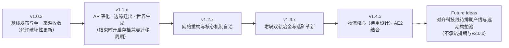

# GT6CE 整体路线图

本文档为 GregTech 6 Community Edition（GT6CE）的整体路线图总览（对应主讨论议题 [#340](https://github.com/GregTech6CE/GregTech6/issues/340)）。路线图遵循**“底层契约与世界/注册基线先行 → 专项系统分阶段攻坚 → 远期构想入池评估”**的渐进原则，避免将过多未定序玩法挤压在同一版本或承诺遥遥无期的 `v2.0.x` 大版本。

各版本的详细**主要内容**、**次要内容**与**错误修复与平衡改进**清单请查阅对应的分版本路线图文档：

- 设计方针、核心特色、三层架构（含 API 窄语义边界）、优先级判据与项目管理规范见 [设计方针与项目管理](../decisions/policies.md)
- 七大人类工业时代科技演进脉络见 [科技演进路线（科技树设计）](../decisions/progression.md)
- 明确不纳入本体或已否决的设计方向见 [尚不考虑 / Out of Scope](out-of-scope.md)

## 版本里程碑总览（主题 — 内容 — 目标）

| 版本 / 构想池 | 主题 | 内容 | 目标 | 详细文档 |
| --- | --- | --- | --- | --- |
| **`v1.0.x`** | **基线发布与单一来源收敛** | 材料注册/成分/回收单一事实来源（#351）；板条箱重构与药水/营养/硬币/废形态/死链流体移除；PNG 无损瘦身与 CI 门禁（#401）、死模型 JSON 清理（#400）；粗矿统合与 `9x 小撮矿 → 1x 粉` 合并；进入世界配方卡顿与岩石互通修复（#229/#325）、普通料斗关闭无效实体搜索（#298）与同格实体上限核查。 | 交付双平台可稳定启动游玩的基准版本，消除核心配方丢失与启动卡顿，机器满足可搜、可开、可输入、拆掉不丢物底线；**此阶段允许破坏性更新，不考虑兼容**。 | [v1.0.x 路线图](v1.0.md) |
| **`v1.1.x`** | **扩展契约稳定、信息可见化与世界/内容定型** | 窄语义 Addon SDK（移除 `BehaviorMachine`）；双端数据与汉化模板化（#358/#359/#399）；原生 6 类运行遥测、游戏内引导手册与 EMI 工具/副产反查；养蜂移除与食物/弹药迁出；连续地层与矿脉/基岩矿重构（#388/#394）；淋雨/雷暴默认关闭、LV 电池死锁与电路板系统调整（方案待定）。 | 稳定对外附属接口与基础交互可读性，完成高风险边缘剥离与世界生成重构；**自本版结束起进入存档兼容周期（此前允许破坏性更新，之后如有变更尽力提供 1～2 个版本内的迁移方案）**。 | [v1.1.x 路线图](v1.1.md) |
| **`v1.2.x`** | **网络重构与核心机制自洽** | **管道与能量网络底层重构**（方案待商榷，推荐边-节点压缩+公平轮询，解决 `288L` 半流体与阀门）；**RU 轴网与齿轮箱确定性重做**；超频下限（#342）、防吞材料（#237）、电池盒（#386）与大型机上限平衡；覆盖板定量限流与调速；回炉收缩/木桶去矩阵/死材料收口。 | 解决全厂级物流、电力与机械传动的性能卡顿、分支饥饿、齿轮箱锁死、多原料抢槽卡死与反直觉限制，补齐机器超频/防吞材料与覆盖板控制闭环。 | [v1.2.x 路线图](v1.2.md) |
| **`v1.3.x`** | **坩埚双轨冶金与选矿革新** | 坩埚全生命周期（前期 `HU+KU` 鼓风炼钢与快凝 → 小/大坩埚分场景自动化）；多腔模具（#355）与回收；配方层温度门槛；`FL.POWER_CONDUCTING` 拆分与显热工质；模块化断头工具；焙烧—湿法与铬铁矿正统链、HF/盐酸闭环、粉末烧结、正向选矿；EMI 矿处树/热力学页与勘探日志。 | 打通坩埚“手工 → 轻谜题 → 大小双轨自动化”全链路，并消除铬铁矿、难熔金属（W/Ta/Nb）与酸碱循环的单点卡死，让冶金与选矿具备可预期、可自动化的多路径选择。 | [v1.3.x 路线图](v1.3.md) |
| **`v1.4.x`** | **原生物流重塑与生态协同** | 【物流核心】重塑（**方案待重新设计**）；AE2 有机结合与桥接；覆盖板可选二级 GUI 与 USB 配置复制；物流核心动态功耗平衡。 | 让纯本体具备区别于数字网络的物理级大规模车间调度能力，并与 AE2 实现互补协同而非相互架空。 | [v1.4.x 路线图](v1.4.md) |
| **`Future Ideas`** | **远期构想与开放性议题池** | 对齐 `progression.md` 的中后期产线（脱硫裂解/合成气/哈伯氨、高分子/PCB、激光/宝石光学、核屏蔽/聚变/QU、规模化多方块）及开放性议题（`1.8~26.1` 原版融入、CSP 光热/温差/卡诺、阶梯并行/准入规范等）。 | 沉淀待验证的中远期玩法方向，**不预设实现顺序、不承诺排期、不画 `v2.0.x` 大饼**，按需通过独立 RFC 认领推进。 | [远期点子池](future-ideas.md) |

## 版本演进脉络

