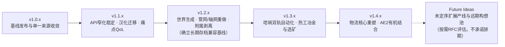

# GT6CE 整体路线图

本文档为 GregTech 6 Community Edition（GT6CE）的整体路线图总览（对应主讨论议题 [#340](https://github.com/GregTech6CE/GregTech6/issues/340)）。路线图遵循**“底层契约与存档基线先行 → 专项系统分阶段攻坚 → 远期构想入池评估”**的渐进原则，避免将过多未定序玩法挤压在同一版本或承诺遥遥无期的远期大版本。

各版本的详细**主要内容**、**次要内容**与**错误修复与平衡改进**清单请查阅对应的分版本路线图文档：

- 设计方针、核心特色、三层架构（含 API 窄语义边界）、优先级判据与项目管理规范见 [设计方针与项目管理](../decisions/policies.md)
- 七大人类工业时代科技演进脉络见 [科技演进路线（科技树设计）](../decisions/progression.md)

## 版本里程碑总览

| 版本 / 构想池 | 阶段战略定位 | 核心里程碑摘要 | 详细文档 |
| --- | --- | --- | --- |
| **v1.0.x** | **基线发布与单一来源收敛** | 材料注册、物品成分与分解/回收链路收敛为单一事实来源（[#351](https://github.com/GregTech6CE/GregTech6/issues/351)）；完成药水、营养、硬币系统移除与板条箱重构；完成打包与图片无损瘦身（[#401](https://github.com/GregTech6CE/GregTech6/issues/401)）；统合 1.17+ 原版粗矿并落地 9x 小撮矿合并；修复进入世界配方注册卡顿与丢失（[#229](https://github.com/GregTech6CE/GregTech6/issues/229)）及原版岩石互通问题（[#325](https://github.com/GregTech6CE/GregTech6/issues/325)）。 | [v1.0.x 路线图](v1.0.md) |
| **v1.1.x** | **API 窄化稳定、汉化迁移与痛点 QoL** | **稳定双平台附属 API 并明确窄语义边界**（仅做配方、能级、换皮机器、世界生成扩展，移除宽定义“行为机”）；完成双端数据层收敛（[#358](https://github.com/GregTech6CE/GregTech6/issues/358)、[#359](https://github.com/GregTech6CE/GregTech6/issues/359)）、汉化迁移与语言模板化（[#399](https://github.com/GregTech6CE/GregTech6/issues/399)）、材质图标收敛（[#384](https://github.com/GregTech6CE/GregTech6/issues/384)）与世界生成调试工具（[#394](https://github.com/GregTech6CE/GregTech6/issues/394)）；上线【原生运行遥测系统】、EMI 工具属性页（[#313](https://github.com/GregTech6CE/GregTech6/issues/313)）、石子外观辨识（[#194](https://github.com/GregTech6CE/GregTech6/issues/194)）与筛粉漏斗提示（[#330](https://github.com/GregTech6CE/GregTech6/issues/330)）。 | [v1.1.x 路线图](v1.1.md) |
| **v1.2.x** | **无缺陷、基本自洽、联动附属化与存档兼容基线** | **确立长期存档兼容基线**：完成连续地层与立体矿脉重构（[#388](https://github.com/GregTech6CE/GregTech6/issues/388) 课题群）；完成养蜂移除、食物与弹药系统迁出为独立附属、复杂成品无损回炉收缩与木桶去矩阵化、无源死材料清退；推进管道与能量网络底层重做（具体方案待定）、RU 传动轴网与齿轮箱确定性重做、电网线损去凑数与超频下限运行（[#342](https://github.com/GregTech6CE/GregTech6/issues/342)）、功率不足不吞材料（[#237](https://github.com/GregTech6CE/GregTech6/issues/237)）及资源治理收口（[#396](https://github.com/GregTech6CE/GregTech6/issues/396)~[#398](https://github.com/GregTech6CE/GregTech6/issues/398)、[#400](https://github.com/GregTech6CE/GregTech6/issues/400)）。 | [v1.2.x 路线图](v1.2.md) |
| **v1.3.x** | **坩埚双轨自动化、热工冶金与选矿革新** | 专注攻坚 GT6 核心冶金主线：打通坩埚“前期保留手工 → 中后期分场景自动化（小坩埚多样小批量 vs 大坩埚大批量）→ 末期自动化挑战”全生命周期，解决大坩埚模板替换、余温、模具冷却、料斗批量投料与 `KU` 输入痛点；落地多腔同步浇铸模具（[#355](https://github.com/GregTech6CE/GregTech6/issues/355)）、焙烧—湿法双轨冶金与铬铁矿正统链、难熔金属粉末烧结、非侵入式正向选矿及模块化断头工具修复升级。 | [v1.3.x 路线图](v1.3.md) |
| **v1.4.x** | **原生物流核心重塑与 AE2 有机结合** | 专注攻坚工业物流与跨模组自动化生态：重塑多方块【物流核心】（零磁盘开销直连储物桶全局索引、多固体+流体成套批次投料、USB 蓝图排产联动），做出区别于数字网络的原生物流特色，并实现与 AE2 现代数字网络的有机结合与桥接适配；配套上线覆盖板可选二级配置 GUI 与 USB 配置复制。 | [v1.4.x 路线图](v1.4.md) |
| **Future Ideas** | **远期玩法点子与待商榷构想池（不承诺实现）** | 收纳尚未确定实现顺序、不作排期或必然实现承诺的扩展玩法与待商榷点子：包含两段式脱硫裂解与合成气（[#308](https://github.com/GregTech6CE/GregTech6/issues/308)）、工程高分子与覆铜湿法蚀刻电子链、激光与 80+ 宝石分波段光学、中期规模化多方块、四维能量高阶支柱、MESU 几何储能、可控核聚变与物理辐射屏蔽、量子奇异元素、下界/末地地质扩展及待商榷的矿物筛选机制。 | [远期点子池](future-ideas.md) |

## 版本演进脉络

